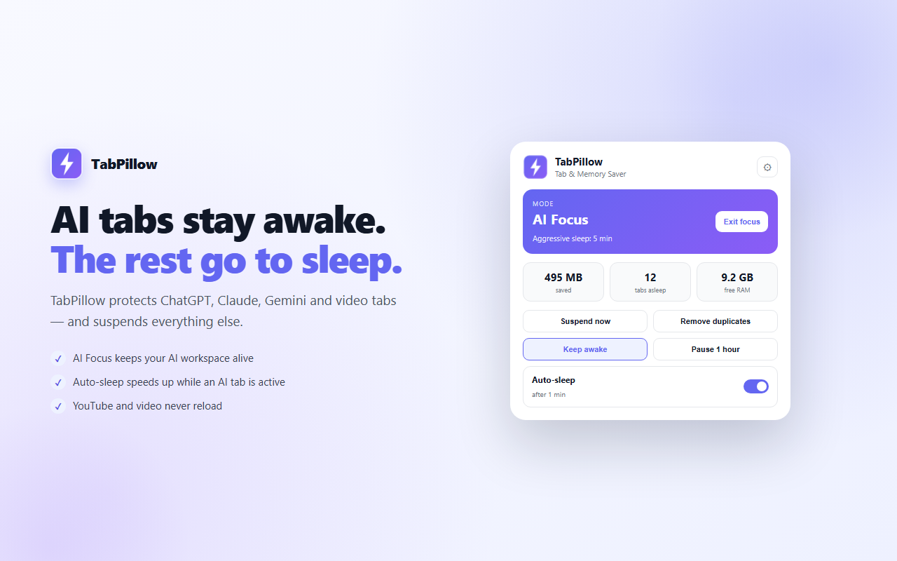
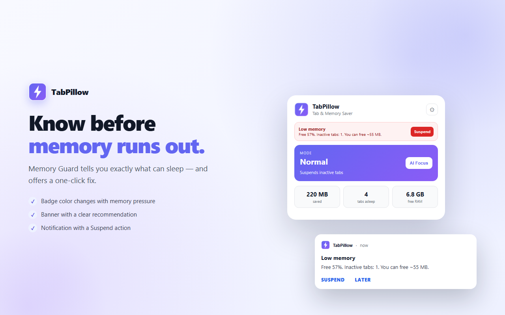
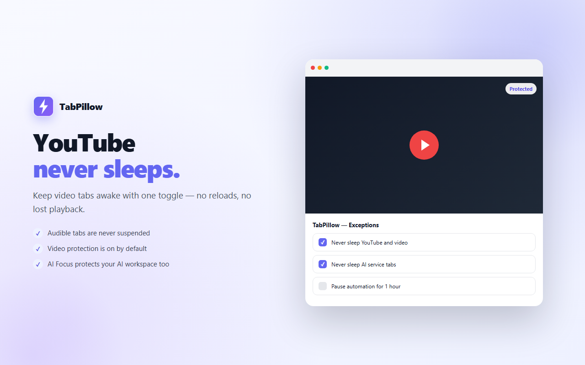
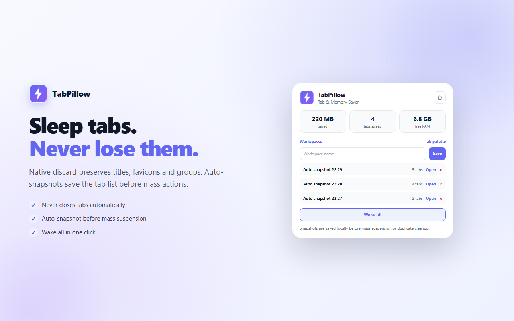

# TabPillow — AI Tab & Memory Optimizer

TabPillow is a free Chrome extension that suspends inactive tabs, frees memory and keeps the tabs
you actually need — ChatGPT, Claude, Gemini, YouTube and other video — awake. Everything runs
locally: no account, no cloud and no telemetry.

## Why TabPillow

Chrome runs a separate process for every tab. Twenty or thirty tabs can easily use 4–8 GB of RAM,
and the browser may reload the tab you were working in. TabPillow suspends what you are not using
and protects what you are.

- **AI Focus** — keeps ChatGPT, Claude, Gemini, Copilot, Perplexity and video tabs awake.
- **Auto AI Focus** — sleeps other tabs sooner while an AI tab is active.
- **Memory Guard** — warns before RAM runs out and estimates what can be freed.
- **Native tab suspender** — uses Chrome's `discard`; titles, favicons, groups and scroll position
  are preserved.
- **Workspaces** — save a window of tabs and restore it later, with automatic snapshots before
  mass suspension.
- **Duplicate cleanup, tab palette, keep-awake, whitelist, schedules.**
- **9 languages, dark theme, keyboard shortcuts.**
- **No remote code, no host permissions, no telemetry.**

## Install

1. Open the [Chrome Web Store listing](https://chromewebstore.google.com/detail/lfhigdmjdkijaahchcbafficjhikcllf).
2. Click **Add to Chrome**. The “Be careful” notice is standard for new extensions; click
   **Install**.
3. Pick a preset on the welcome page or skip it.
4. Pin TabPillow via the puzzle icon next to the address bar.

Works in Chrome, Edge, Opera and other Chromium browsers (Manifest V3). The Chrome Web Store may be
blocked in some regions; the extension itself works locally after installation.

## Screenshots

| AI Focus | Memory Guard |
| --- | --- |
|  |  |

| YouTube stays awake | Workspaces |
| --- | --- |
|  |  |

## Privacy

- No analytics, telemetry or account inside the extension.
- Settings, statistics and workspaces stay in `chrome.storage`.
- No host permissions and no content scripts: TabPillow does not read page contents.
- The website uses cookie-less, aggregated analytics (Umami Cloud); this is separate from the
  extension.

Read [docs/privacy.md](docs/privacy.md) and [docs/permissions.md](docs/permissions.md).

## Documentation

- [Help & quick start](docs/help.md)
- [Permissions explained](docs/permissions.md)
- [Privacy policy](docs/privacy.md)
- [Changelog](docs/changelog.md)
- [FAQ](docs/faq.md)

## Guides

- [Chrome Memory Saver not working](https://gettabpillow.fun/blog/en/memory-saver-fix.html)
- [Tab suspender for Chrome](https://gettabpillow.fun/blog/en/suspend-tabs.html)
- [The Great Suspender alternative](https://gettabpillow.fun/blog/en/great-suspender-alternatives.html)
- [How to save tabs in Chrome](https://gettabpillow.fun/blog/en/save-tabs.html)

More on the website: [gettabpillow.fun](https://gettabpillow.fun/) ·
[blog](https://gettabpillow.fun/blog/en/) · [demo videos](https://gettabpillow.fun/video/en/) ·
[donate](https://gettabpillow.fun/en/donate.html).

## This repository

This is a **documentation and feedback repository**. The extension source code is proprietary and
not published here. Issues and feature requests are welcome — see
[CONTRIBUTING.md](CONTRIBUTING.md).

- Bug report: use the issue template.
- Security issue: follow [SECURITY.md](SECURITY.md), do not open a public issue.
- Brand: TabPillow name and logo are trademarks; see [TRADEMARK.md](TRADEMARK.md).

## License

Documentation and screenshots in this repository are licensed under
[CC BY 4.0](https://creativecommons.org/licenses/by/4.0/). The extension itself is proprietary
freeware. See [LICENSE](LICENSE).
